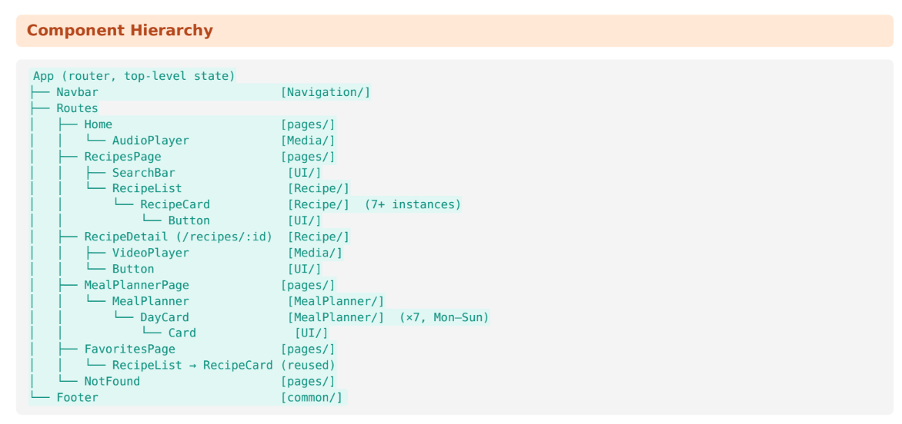
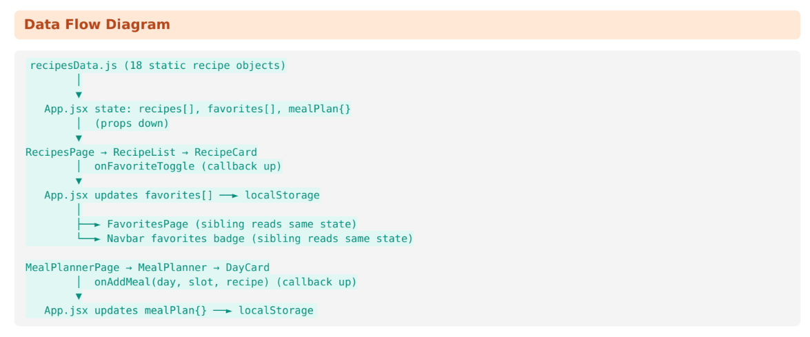

# Component Hierarchy

# Data Flow Diagram

# Components and purposes
| Components | Purposes |
|---|---|
| Pages | Home (intro and audio tip), RecipesPage (search, filters, catalog), RecipeDetail (full recipe), MealPlannerPage, FavoritesPage, NotFound (404) |
| Recipe | RecipeList (grid), RecipeCard (summary and favorite button), RecipeFilter (category and cuisine selects) |
| MealPlanner | MealPlanner (weekly grid), DayCard (one day, reused ×7) |
| Media | VideoPlayer (YouTube embed or video), AudioPlayer (cooking tip) |
| UI (reusable) | Button, Card, SearchBar, Loading, Modal |
| Navigation | Navbar (links, active state, favorites count, hamburger menu) |

# Props flow
1. favorites, onFavoriteToggle:
App → RecipesPage → RecipeList → RecipeCard. recipes comes from recipesData.js in RecipesPage.

2. mealPlan, onAddMeal, onRemoveMeal, onClearWeek:
App → MealPlannerPage → MealPlanner. DayCard then receives day, meals and allRecipes.

3. searchTerm, onSearchChange:
RecipesPage → SearchBar.

4. Card and Modal:
Accept children.

5. RecipeCard, DayCard, Button, SearchBar, and RecipeFilter:
Use PropTypes.
DayCard has the default allRecipes = [].