## 🔥THE FLAMING INFERNO🔥Recipe App
### Scorching your tastebuds with unbelievable flavor!

Welcome to **The Flaming Inferno**, the single-page recipe app where every dish is turned up to eleven. Built with **React** and **Vite** for blazing-fast performance, it puts a hand-picked collection of the finest recipes at your fingertips, sourced from culinary heavyweights like **The Preppy Chef**, **Ntsako**, and other top creators.

## What You Can Do

-**Browse** a curated selection of mouth-watering recipes
-**Dive into the full details**: ingredients, steps, everything you need
-**Watch the YouTube tutorial** and cook along with the pros
-**Save your favorites** so the best dishes are always one click away
-**Plan your meals for the entire week** and never ask "what's for dinner?" again

## Built With

- React
- Vite

Fire up the stove. Your next favorite meal is waiting.

## Features List:
1. Recipe catalog- 18 recipes for breakfast, lunch, dinner, dessert, and snacks, each with an image, cook time, difficulty level and servings
2. Search Bar- search for the recipe you're looking for using the title
3. Filter Bar- filter according to category and cuisine
4. Simulated loading state- simulated delay which shows a spinner
5. Recipe Detail page- shows an image of the dish, step-by-step instructions as well as an embedded video tutorial(Youtube links are embedded using iframe)
6. Favorites-heart button which allows you to favorite and unfavorite
7. Meal Planner- Monday to Sunday meal planning for three meals of the day
8. Responsive navigation- navbar collapses into hamburger menu
9. 404 page- for unmatched routes

## Technologies Used:
1. React
2. React Router DOM(BrowserRouter, nested routes, useParams, useNavigate, useLocation)
3. Proptypes
4. Vite
5. CSS Module
6. ESLint

## Component Architecture:
The app follows a pages to feature components to UI primitives structure:

- **Pages** (`pages/`) are route-level components. They own page-specific local state (search term, filters, simulated loading) and receive shared app state as props from `App.jsx`.
- **Feature components** are grouped by domain: Recipe (card, list, filter, detail), MealPlanner (weekly grid, day cards), Media (audio/video players), Navigation (navbar).
- **UI primitives** (`components/UI/`) are small, presentation-only pieces (Button, Card, Modal, Loading, SearchBar) reused across the app. Card accepts an optional `className` so pages can adjust its layout.

Each component is styled with its own CSS Module, and props are validated with PropTypes.

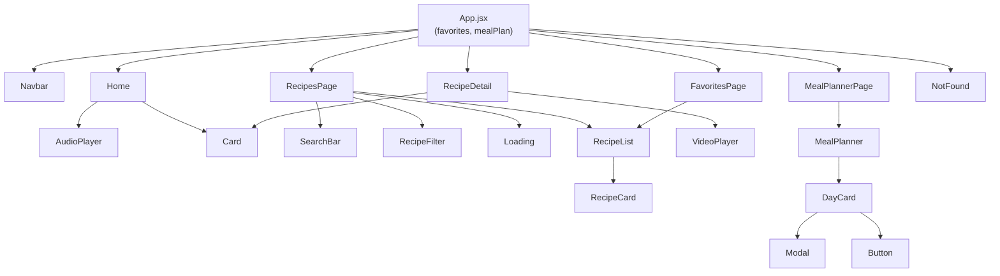

## Installation Instructions:
# Step 1:
Clone repo into your Vs Code

# Step 2:
In your terminal, navigate to the right file using "cd react-recipe-app-Maddyno1/recipe-app"

# Step 3:
In your terminal run "npm install" and then "npm start" OR "npm run dev"

## Project Structure:
- **`components/`** is grouped by domain, with one CSS Module per folder.
- **`pages/`** holds the route-level components.
- **`data/` and `utils/`** keep the recipe data and helper functions out of the components.
- **`App.jsx`** owns the shared state (`favorites`, `mealPlan`) and declares all routes.

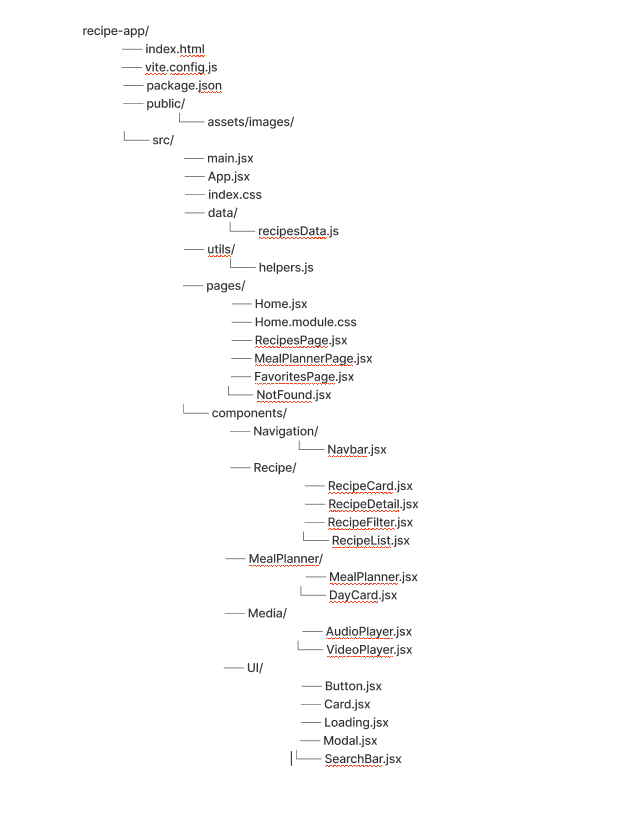

## Component Descriptions:
Navbar
Top navigation bar with links to all pages, a live favorites counter, and a collapsible mobile menu.

RecipeCard
Displays a single recipe's image, title (linked to its detail page), difficulty/time/servings, and a favorite toggle button.

RecipeList
Renders a responsive grid of RecipeCards from a list of recipes.

RecipeFilter
Two <select> dropdowns for filtering by category and cuisine.

RecipeDetail
Full detail view for one recipe — ingredients, instructions, difficulty badge, and embedded video tutorial. Looked up by id from the URL.

MealPlanner
Renders one DayCard per day of the week.

DayCard
Shows breakfast/lunch/dinner slots for a single day; opens a Modal to assign a recipe to an empty slot, or remove a filled one.

AudioPlayerRenders an HTML5 <audio> element with an optional cover image and title, used on the Home page's "Cooking Tip of the Day" card.

VideoPlayer
Renders a YouTube iframe embed when given a YouTube URL, or a native <video> element for direct video files. Used on RecipeDetail.

Button
Reusable button with primary/secondary/danger style variants.

CardGeneric bordered container with an optional title and className, used to group content.

Modal
Overlay dialog with a backdrop-click-to-close and an explicit close button.

Loading
Spinner + message shown while recipes are "loading".

SearchBar
Controlled text input with a submit button for the recipe search.

## State Management:
State uses React's built-in hooks and is passed down via props. There is no global store.

- **Shared state lives in `App.jsx`:** `favorites` (array of recipe objects) and `mealPlan` (an object keyed by day, each with `breakfast`, `lunch` and `dinner` slots). `App` also defines the handlers that change it: `handleFavoriteToggle`, `handleAddMeal`, `handleRemoveMeal` and `handleClearWeek`.
- **Page-local state** (search term, selected category and cuisine, loading flag) lives in `RecipesPage`. The modal's open slot lives in `DayCard`.
- **Persistence:** both shared values are saved to `localStorage` in `useEffect` hooks. On startup they are loaded through lazy `useState` initializers, wrapped in `try/catch` with shape checks, so corrupt or missing saved data falls back to empty defaults instead of stopping the app from opening.
- **Static data:** recipes are read from `data/recipesData.js` and are not stored in state.

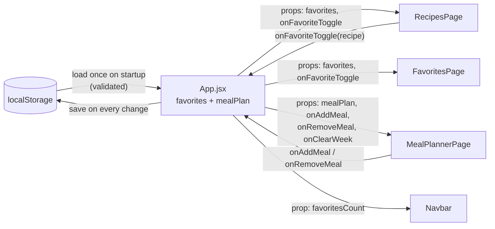

## Routing:
Built with react-router-dom v7 using BrowserRouter, all declared in App.jsx.
| Path | Component | Purpose |
|---|---|---|
| `/` | Home | Landing page with intro text and a "Cooking Tip" audio card |
| `/recipes` | RecipesPage | Full catalog with search and filters |
| `/recipes/:id` | RecipeDetail | Detail view for one recipe, found by numeric `id` via `useParams`. An unknown id shows a "Recipe not found" message with a back button |
| `/meal-planner` | MealPlannerPage | Weekly meal planner grid |
| `/favorites` | FavoritesPage | Favorited recipes, or an empty-state message |
| `*` | NotFound | Catch-all 404 page |

`useNavigate` is used for the back buttons, and `useLocation` for highlighting the active nav link.

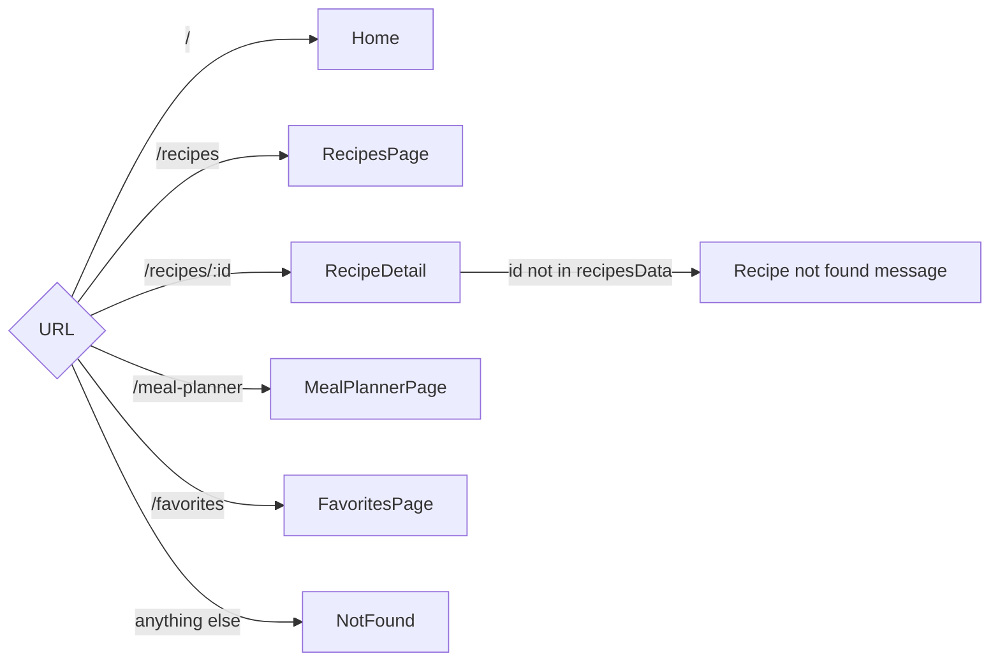

## Future Enhancements:
Generate a shopping list from a week's meal plan.
Add drag-and-drop for assigning recipes in the meal planner instead of the modal picker.
Add pagination or infinite scroll for larger recipe catalogs.
Add a dark mode toggle.

## Screenshots:
Home page
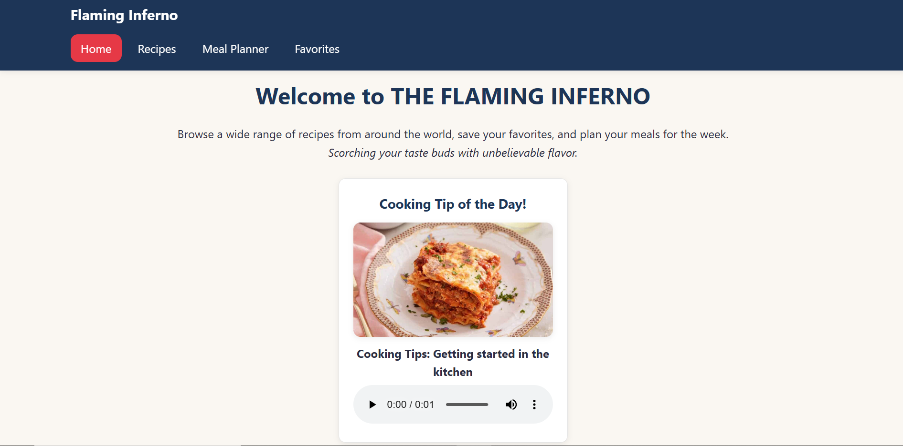
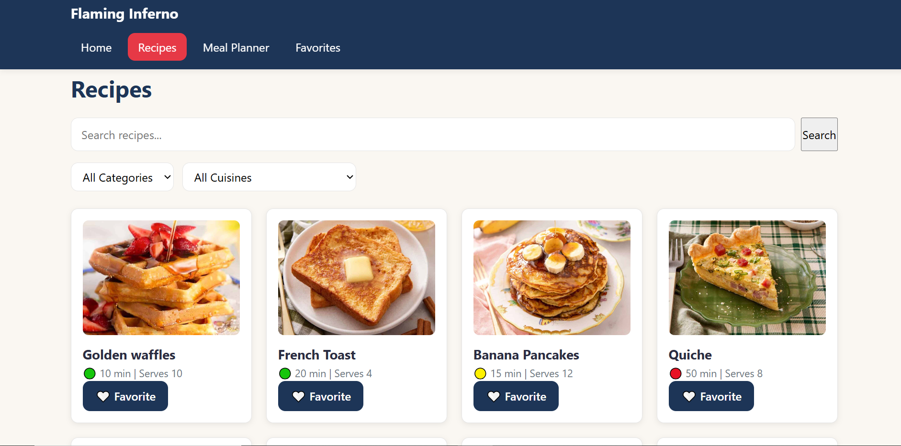
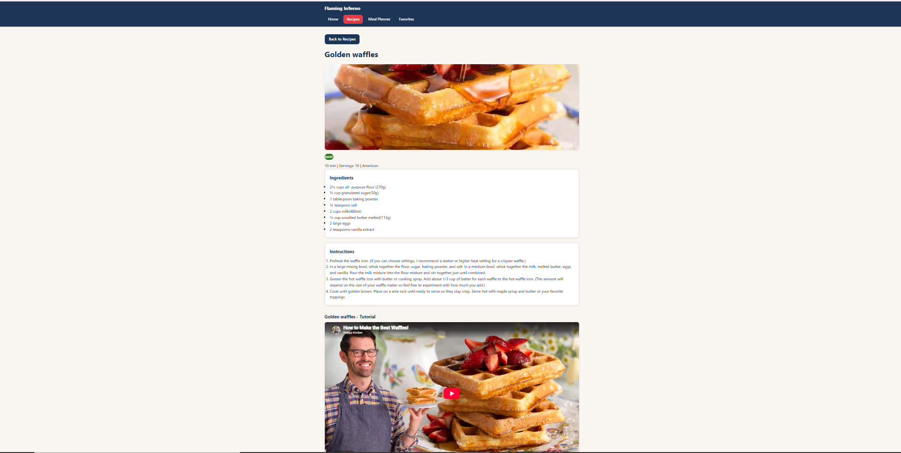
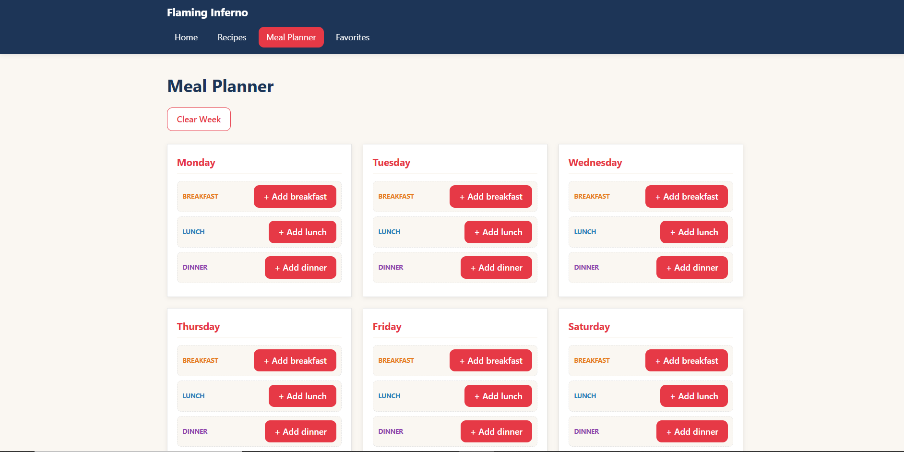
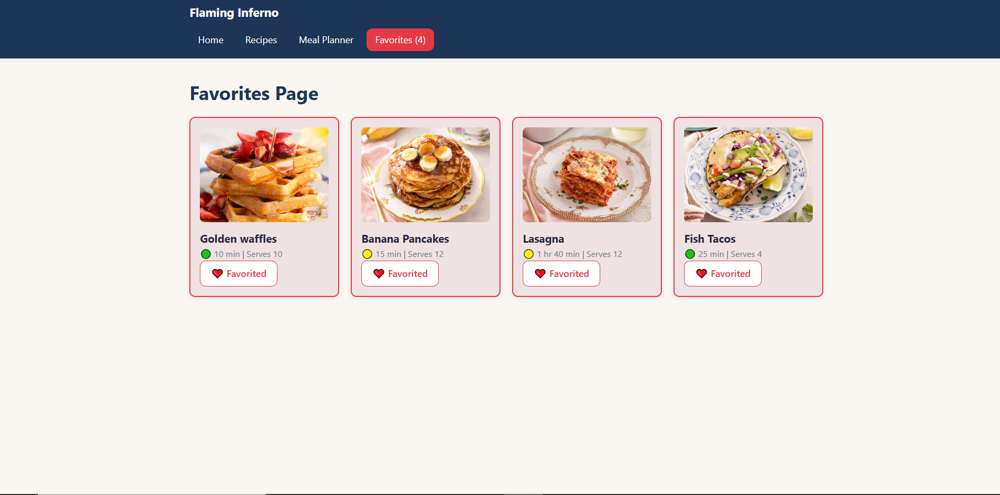
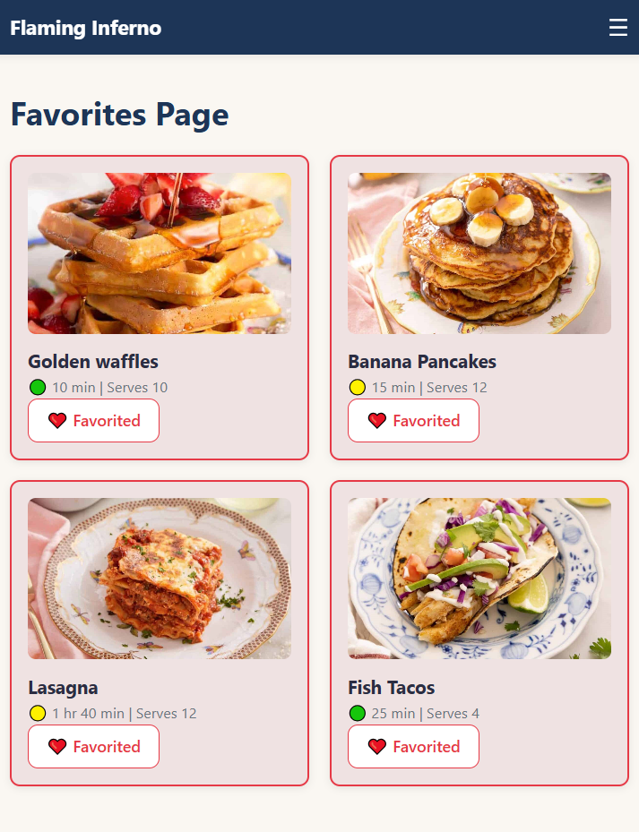
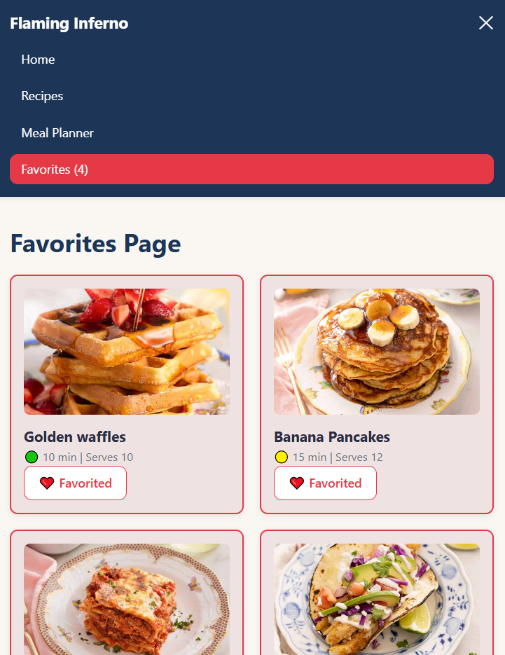
